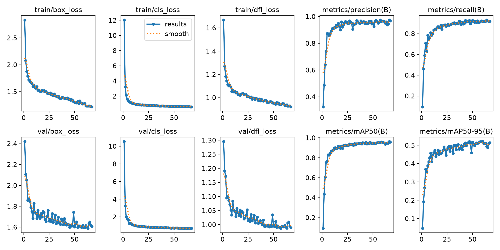
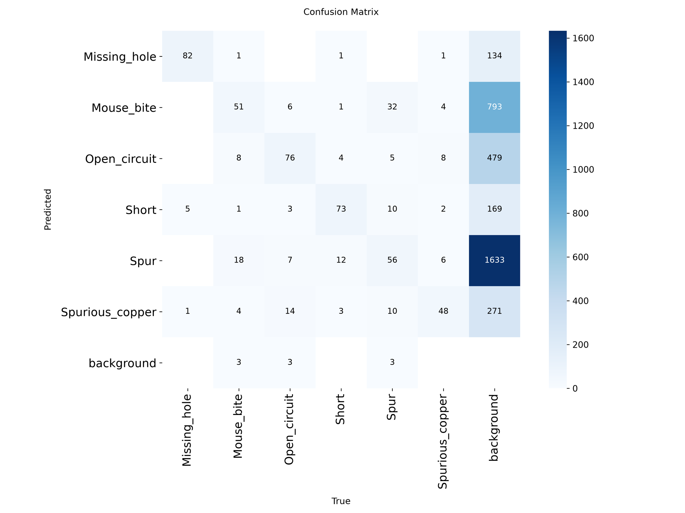
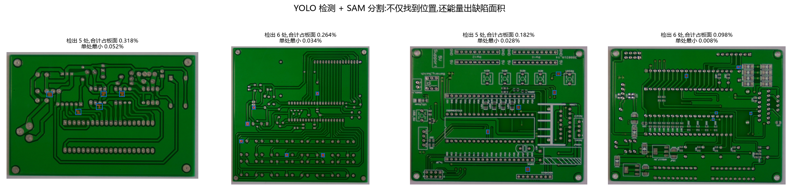

# 实验结果

## 一、实验设置

| 项目 | 设置 |
| --- | --- |
| 数据集 | PCB 缺陷数据集(HRIPCB 格式),6 类缺陷 |
| 规模 | 693 张图、2953 个标注框 |
| 划分 | 训练 555 张(2391 框)/ 验证 138 张(562 框),固定随机种子 |
| 传统方案 | YOLO11n,输入 1024,67 轮早停 |
| 大模型方案 | DeepSeek `deepseek-flash`,零样本,三种思考强度 |
| 对比方式 | 两种方案跑**同一批 138 张验证集图片** |

指标定义:

* **类型判断准确率**——每张图真实只含一种缺陷,看方法是否正确指出该类型;
* **检出率**——是否至少报出一个缺陷(漏检 = 0 个);
* **数量误差**——报出的缺陷个数与真实个数之差的平均值;
* **误报类型数**——报出的类型里,图片中根本不存在的类型个数;
* **定位误差**——报出的缺陷中心与最近的真实框中心的距离(按图像对角线归一化,0 表示完全重合)。

## 二、为什么这个任务难:先看数据


三个数字决定了任务性质:

1. 类别分布均匀:每类 115~116 张图、482~503 个框,不存在类别不平衡干扰;
2. **缺陷极小**:缺陷框最长边中位数仅 **78 像素**,只占图像长边的 **2.85%**;
3. 用 SAM 分割进一步量化后,缺陷面积中位数**只占整张图的 0.037%**——
   一万个像素里只有三四个是缺陷。

这是典型的**微小目标检测**,也正是两种技术路线差距最大的场景。

## 三、传统方案:YOLO 检测 + SAM 分割

### 3.1 YOLO11n 训练结果

| 指标 | 数值 |
| --- | --- |
| mAP50 | **0.956** |
| mAP50-95 | 0.521 |
| 精确率 P | 0.955 |
| 召回率 R | 0.929 |
| 训练轮次 | 67(早停,约 14 分钟) |

> 说明:训练曲线里 mAP50 的峰值约为 0.963(第 66 轮),而最终交付的 `best.pt`
> 在验证集上是 0.956——因为 ultralytics 按综合适应度(fitness)选择最佳权重,
> 并非单纯取 mAP50 最高的那一轮。文档统一采用 `best.pt` 的实际验证结果。





### 3.2 SAM 分割:从"框"到"面积"

以 YOLO 检出的框作为提示,交给 SAM 2.1 生成精确掩膜。这一步带来了
两种方案之间一个新的对比维度——**缺陷面积的量化**。



统计结果(138 张验证集):缺陷面积占整图比例**中位数 0.037%**,
最大 0.448%,最小 0.007%。有了面积就能客观划分严重程度
(例如"占板面 0.1% 以上算明显缺陷"),**而这是大模型给不出的**——
它只能给出"轻微/明显"这类主观描述。

## 四、大模型方案:三档思考强度

`deepseek-flash` 默认开启思考模式且强度为 high。它的输出 token 中绝大多数
是推理过程而非最终答案,所以思考强度直接决定了耗时与成本。

| 思考强度 | 类型判断准确率 | 检出率 | 单张耗时 | 整批 token | 整批花费 |
| --- | --- | --- | --- | --- | --- |
| 关闭 | 9.4% | 46.4% | 1.8 秒 | 179,285 | $0.03 |
| 低 | 44.2% | 52.2% | 49.3 秒 | 1,126,229 | $0.60 |
| 高(默认) | **65.9%** | **76.1%** | 82.4 秒 | 1,990,311 | $1.12 |

可以清楚看到一条**收益递减、代价递增**的曲线:思考强度从关闭到高,
类型判断从 9.4% 提升到 65.9%(约 7 倍),但耗时涨了 45 倍、token 涨了 11 倍。

> 需要说明:高强度组有 6 张因网络传输中断失败(`Response ended prematurely`),
> 按"未检出"计入统计,这一处理对大模型略为不利,但影响很小(6/138)。

## 五、量化对比

| 方法 | 类型判断准确率 | 漏检率 | 数量误差 | 误报类型数 | 定位误差 | 单张耗时 |
| --- | --- | --- | --- | --- | --- | --- |
| **传统检测(YOLO)** | **97.8%** | **2.2%** | 0.33 | 0.07 | **0.003** | **0.054 秒** |
| 大模型 · 关闭思考 | 9.4% | 53.6% | 3.25 | 0.57 | 0.218 | 1.85 秒 |
| 大模型 · 低强度思考 | 44.2% | 47.8% | 2.92 | 2.16 | 0.249 | 49.3 秒 |
| 大模型 · 高强度思考 | 65.9% | 23.9% | 2.90 | 3.25 | 0.251 | 82.4 秒 |


## 六、并排可视化

同一张图上,真实标注、传统检测、视觉大模型三者的判断放在一起比较。
样本特意覆盖三类典型情况,大模型用的是它表现最好的一档(高强度思考),
这样对比对它最公平。


从上到下:

* 前两行——大模型判断基本正确(真实是开路/毛刺,它也报出对应类型);
* 中间两行——**大模型完全漏检**,回答"未发现缺陷",而 YOLO 五处全部找到;
* 后两行——**大模型过度报错**,把 6 类缺陷各报一遍,红叉位置与真实缺陷对不上。

## 七、分析与讨论

### 1. 传统模型在精度、速度、定位三个维度全面领先

类型判断 97.8% 对最高 65.9%;漏检率 2.2% 对 23.9%;定位误差 0.003 对 0.251
(相差约 80 倍);单张耗时 0.054 秒对 82.4 秒(**约 1500 倍**)。

### 2. 大模型的"思考强度"是真实的成本-质量权衡

从 9.4% 到 65.9% 的提升说明推理确实有用,但 45 倍的耗时增长意味着
**它不适合放进任何需要实时响应的流程**。工程上更现实的做法是:
把大模型放在离线或异步环节(比如生成质检报告),而不是产线上的逐帧判断。

### 3. 两个与预期相反的发现

**第一,想得越多,误报反而越多。** 关闭思考时平均误报 0.57 种类型,
高强度思考时涨到 3.25 种。它在"努力推理"时会更倾向于给出一个判断,
即使证据不足——这与"想得越多越谨慎"的直觉相反。

**第二,长思考请求的工程可靠性更差。** 高强度组有 6 张因网络传输中断失败。
这不是模型能力问题,而是"请求时间越长、被中断的概率越高"——
在真实部署里,这是必须考虑的成本。

### 4. 为什么大模型会输:三个原因

1. **目标太小**:缺陷只占画面面积的 0.037%,通用视觉模型的分辨能力不够;
2. **零样本**:它没有见过这个任务的标注,而 YOLO 用了 555 张带标注图训练;
3. **任务需要精确坐标**:大模型擅长"描述",不擅长"精确定位",
   它给出的中心点与真实位置相差约 0.25 个对角线长度。

## 八、结论:各自适合什么场景

| 场景特征 | 推荐方案 | 理由 |
| --- | --- | --- |
| 有标注数据、追求精度与实时性(产线质检) | **传统检测模型**(YOLO + SAM) | 精度 97.8%、单张 54 ms、可量化面积 |
| 没有标注数据、需要快速验证可行性 | 大模型(高强度思考) | 零样本可用,不用训练,65.9% 的类型判断仍有参考价值 |
| 需要语义解释与处理建议(生成质检报告) | 大模型 | 能输出自然语言判断,这是检测模型做不到的 |
| 需要客观量化严重程度 | 传统模型 + SAM | 可给出缺陷面积,不依赖主观描述 |

**一句话总结:两者是互补而非替代。** 专用模型负责"看见并量准",
通用大模型负责"看懂并解释";在有标注的工业场景里,前者目前不可替代,
后者更适合承担离线分析与报告生成的角色。

## 九、复现方式

```bash
uv sync
uv run scripts/check_env.py              # 环境自检
uv run scripts/download_dataset.py      # 下载数据集
uv run scripts/analyze_dataset.py       # 数据统计
uv run scripts/prepare_yolo_dataset.py  # 标注转换
uv run scripts/train_yolo.py --epochs 100 --imgsz 1024 --batch 8
uv run scripts/yolo_infer.py            # 传统方案推理
uv run scripts/llm_infer.py --effort low --workers 6   # 大模型方案(需 API key)
uv run scripts/sam_segment.py           # YOLO + SAM 分割
uv run scripts/compare_methods.py       # 量化对比
uv run scripts/visualize_side_by_side.py  # 并排可视化
```

大模型方案需要环境变量 `DEEPSEEK_API_KEY`(本项目通过环境变量读取,未写入仓库)。
