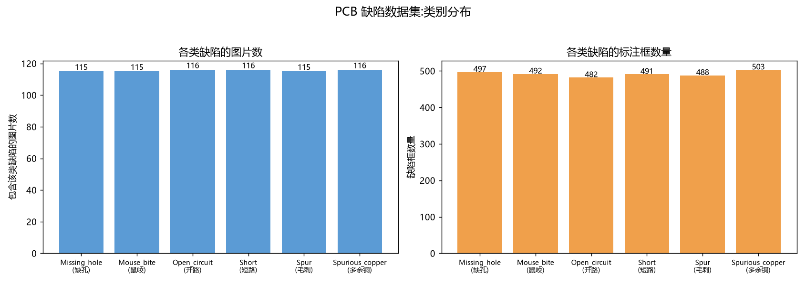
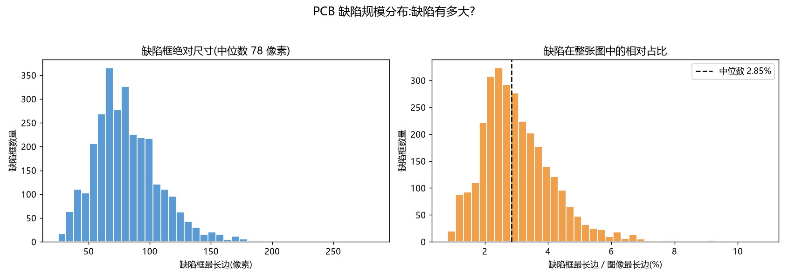
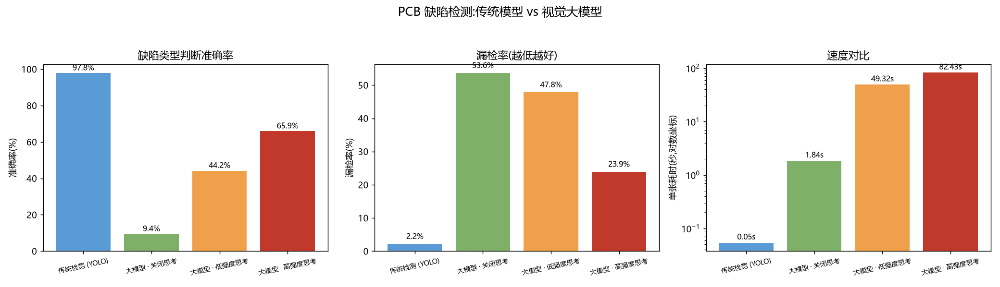
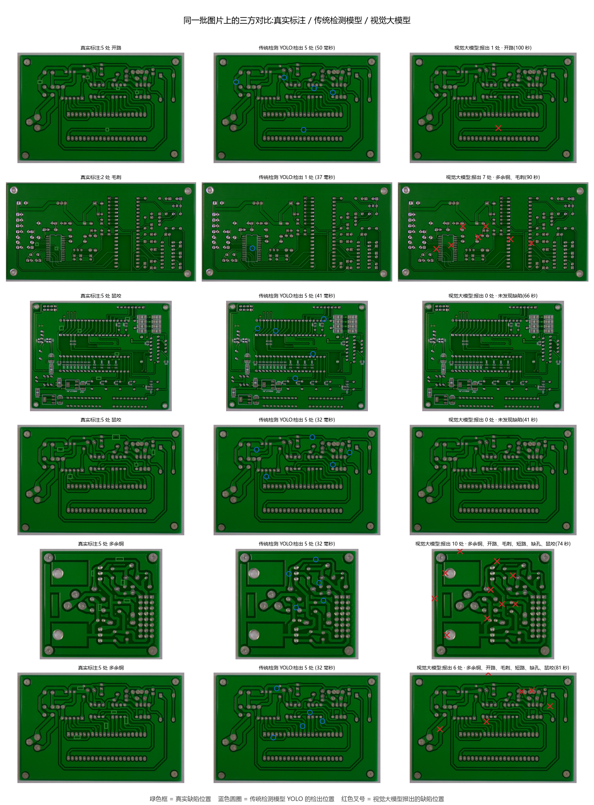

# 工业 PCB 表面缺陷检测:传统检测模型与视觉大模型的对比

## 一、项目简介

本项目针对工业 PCB 表面缺陷检测这一视觉任务,用两条完全不同的技术路线分别解决,
并在**同一批图片**上做量化对比:

- **传统深度学习方案**:YOLO11n 检测缺陷位置与类别,再用 SAM 2.1 由检测框提示生成精确掩膜;
- **视觉 / 多模态大模型方案**:调用 DeepSeek 的 `deepseek-flash` 对同一批图片做零样本判断。

对比的结论不是"谁更强",而是"**各自适合什么场景**"。

## 二、选题说明

考核给出了三个参考项目方向(桌面物品清点、垃圾识别与分类、图像观察与问答),
并要求不能直接提交参考项目。因此本项目选择了一个与三者都不同的场景:
**工业 PCB 表面缺陷检测**。

选择理由:

1. 工业质检是视觉检测的真实落地场景,与本人的机电/自动化背景相关;
2. PCB 缺陷极小——分割后测得**缺陷面积中位数只占整图的 0.037%**,
   是典型的微小目标检测问题,正好能检验两种技术路线的能力边界;
3. 数据集公开、体积小、许可清晰(MIT),实验完整可复现。

## 三、数据集

### 3.1 来源与规模

| 项目 | 数值 |
| --- | --- |
| 来源 | Hugging Face 数据集 `RobotHuman/PCB_defect`(HRIPCB 格式) |
| 类别数 | 6(缺孔、鼠咬、开路、短路、毛刺、多余铜) |
| 图片数 | 693 张 |
| 标注框 | 2953 个(平均每张 4.3 个缺陷) |
| 划分 | 训练 555 张(2391 框)/ 验证 138 张(562 框) |
| 标注格式 | PASCAL VOC,已转换为 YOLO 格式 |

### 3.2 统计分析





三个关键数字:

1. **类别均衡**:每类 115~116 张图、482~503 个框,不存在类别不平衡干扰;
2. **缺陷极小**:缺陷框最长边中位数仅 78 像素,只占图像长边的 2.85%;
3. **面积更直观**:SAM 分割后测得缺陷面积中位数只占整图 **0.037%**。

每张图内只含一种缺陷类型、但有 4~6 处,因此"类型判断"和"数量清点"
是两个可以分开评价的子任务。

## 四、技术方案

### 4.1 传统方案:YOLO 检测 + SAM 分割

检测模型用 YOLO11n,输入尺寸提到 **1024**——缺陷最长边中位数只有 78 像素,
默认的 640 会把缺陷压缩到十几个像素,漏检会明显增加。

训练 67 轮早停(约 14 分钟),验证集 mAP50 **0.956**、mAP50-95 0.521、召回 0.929。

随后以检测框为提示调用 **SAM 2.1** 生成分割掩膜。这一步的价值是把"缺陷在这一带"
变成"缺陷面积有多大",从而可以**客观划分严重程度**。

### 4.2 大模型方案:DeepSeek 视觉模型

`deepseek-flash` 支持图片输入,且与 OpenAI 接口兼容。方案要点:

1. 图片缩放到长边 1536 后以 base64 传入;
2. 用提示词要求模型输出**结构化 JSON**:缺陷类型、所在区域、归一化坐标、严重程度;
3. 控制**思考强度**(`reasoning_effort`):默认是 high,会先输出大量推理再给答案,
   因此分别测试了"关闭 / 低 / 高"三档。

## 五、实验结果

两种方案在 **138 张验证集**上的对比:

| 方法 | 严格命中 | 类型精确率 | 漏检率 | 定位误差 | 单张耗时 |
| --- | --- | --- | --- | --- | --- |
| **传统检测(YOLO)** | **90.6%** | **93.1%** | **2.2%** | **0.003** | **0.054 秒** |
| 大模型 · 关闭思考 | 5.1% | 14.3% | 53.6% | 0.218 | 1.85 秒 |
| 大模型 · 低强度思考 | 1.4% | 17.0% | 47.8% | 0.249 | 49.3 秒 |
| 大模型 · 高强度思考 | **0.7%** | **16.9%** | 23.9% | 0.251 | 82.4 秒 |

> 表中"严格命中"指预测的类型集合与真实集合完全一致。若只要求"包含真实类型",
> 高强度档看起来有 65.9%——但它在 65 张图上把 6 类缺陷全报了一遍,
> **高命中是大量误报堆出来的**,所以本文统一采用严格口径与精确率。





完整的指标定义、逐项分析与适用场景见 [实验结果](实验结果.md)。

## 六、创新点

1. **自主选题与真实场景**:选择工业 PCB 缺陷检测,与三个参考方向都不同;
2. **思考强度作为实验变量**:同一个大模型跑关闭/低/高三档,
   得到"效果提升 7 倍、耗时增加 45 倍"的成本-质量曲线;
3. **从检出到量化**:YOLO 检出 + SAM 分割,把缺陷从"位置"推进到"面积",
   为严重程度划分提供客观依据;
4. **多维对比而非单一指标**:除准确率外,还比较漏检率、数量误差、误报类型数、
   定位误差、耗时与成本;
5. **指标口径的反思**:发现"只要包含真实类型就算对"的宽松口径会被"全报一遍"钻空子,
   因此同时给出严格命中率与类型精确率,避免得出虚假的高分;
   另外还发现大模型思考越多误报越多、长思考请求更容易因网络中断失败。

## 七、局限与改进方向

1. **对比并不完全对等**:传统模型用了 555 张标注图训练,而大模型是零样本。
   这个差异正是结论的一部分——"有标注时专用模型更强",但如果一开始没有标注,
   大模型仍能在无训练成本的情况下给出大致判断;
2. **验证集存在选择偏差**:YOLO 的最佳权重是按验证集挑选的,随后又在同一验证集上
   评估,指标会略偏乐观;更严谨的做法是另留一份独立测试集;
3. **大模型结果不完全可复现**:思考模式下不支持 temperature,
   同一张图多次调用可能给出不同答案,本次没有做多次采样取平均;
4. **数据集规模偏小**:693 张图、单一来源,泛化性没有验证;
5. **SAM 掩膜只做了面积统计**,没有对掩膜质量做定量评估(如 IoU);
6. **只测了一个大模型**:不同厂商的视觉模型能力差异较大,结论只适用于 DeepSeek;
7. **API 的价格与版本会变化**,实验成本数字只代表测试当时的情况。

## 八、个人感悟

第一阶段我做的是"把一个模型从零搭出来",这次的任务完全不同——**同一个问题,
用两条技术路线各做一遍,再判断谁适合什么场景**。刚开始我以为大模型会赢,
毕竟它"什么都见过";结果跑完才发现,在这种缺陷只占画面万分之四的任务上,
它连"有没有缺陷"都经常看不出来。

最大的转变是**不再只看准确率**。以前我觉得 97.8% 和 65.9% 就是"好和不好",
这次做完才意识到,还要看代价:大模型想得越多,耗时从 1.8 秒涨到 82 秒,
长了 45 倍,而且长请求还会因为网络中断失败。**一个方案能不能用,
取决于它在什么约束下运行**,这句话是我这次体会最深的。

还有一个意外发现让我印象很深:我以为"想得越多会越谨慎",实际却相反——
高强度思考时它报出的错误类型更多。看着并排图里那些撒得到处都是的红叉,
我第一次直观地感受到"模型很自信地说错话"是什么样子。

对 AI 辅助开发的感受和第一阶段一样:它帮我省下了大量搭代码的时间,
写数据管道、调 API、画对比图这些机械工作几乎不用我操心。但**实验怎么设计、
结果说明什么、结论能不能站住,还是得自己想**——这次"思考强度三档对比"
就是我反复想"到底该怎么证明它不可靠"才定下来的。

如果继续做下去,我想试两件事:一是把 YOLO 的检出结果和用大模型生成的质检报告
串成一条流水线,让机器负责看、模型负责写;二是在更多种类的工业缺陷数据上验证,
看看这套"专用模型 + 通用大模型"的组合在别的场景是不是同样成立。

## 九、运行方式

```bash
uv sync
uv run scripts/check_env.py               # 环境自检
uv run scripts/download_dataset.py       # 下载数据
uv run scripts/analyze_dataset.py        # 数据统计
uv run scripts/prepare_yolo_dataset.py   # 标注转换
uv run scripts/train_yolo.py             # 训练检测模型
uv run scripts/yolo_infer.py             # 传统方案推理
uv run scripts/llm_infer.py --effort low # 大模型方案(需 DEEPSEEK_API_KEY)
uv run scripts/sam_segment.py            # YOLO + SAM 分割
uv run scripts/compare_methods.py        # 量化对比
uv run scripts/visualize_side_by_side.py # 并排可视化
```
